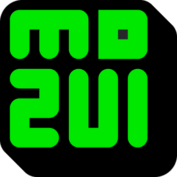

<p align="center">
  
</p>

# md2ui

> **md2ui is experimental.** Its Markdown conventions, `THEME.md` keys, CLI, MCP tools and
> Python API can change between any two releases. It is tested on macOS only.

**md2ui turns an ordinary Markdown document, such as an LLM's answer, into a rendered UI.**

## What it is for

An agent writes its reply as plain Markdown; md2ui groups it, lays it out and draws it as
UI, styled by a `THEME.md` that belongs to the app showing it. Clicks on the buttons the
agent wrote come back to the agent as sentences built from its own Markdown. The questions
behind it: can plain Markdown carry enough to generate a good UI, can that UI couple with an
existing front end's design system, and how cheap and compact can it be for the model that
writes it?

The design comes from patterns observed in real LLM answers, from UI design samples and from
several Gestalt principles, not from a spec: "what should this do?" is answered by looking at
documents and designs.

## Install

md2ui needs Python 3.13 or later. It depends on `skia-python` and `glfw`, and is tested on
macOS. Only pre-releases exist: pip needs `--pre`, or pin the version.

On Linux, `skia-python` loads the system's OpenGL and fontconfig libraries, which a minimal
install lacks (md2ui then stops with `libEGL.so.1: cannot open shared object file`). On
Debian or Ubuntu:

```
sudo apt install libgl1 libegl1 libfontconfig1
```

**The CLI, the app and the MCP servers**, as commands on your `PATH`:

```
uv tool install md2ui                    # or: pip install --pre md2ui
uvx --from md2ui==0.1.0a1 md2ui render path/to/content.md    # one command, nothing installed
```

**The library, for a backend** that sends md2ui Markdown to its frontends:

```
uv add md2ui                             # or: pip install --pre md2ui, or pin md2ui==0.1.0a1
```

**From git**, a release tag or the latest `main`, instead of PyPI:

```
uvx --from git+https://github.com/md2ui/md2ui@v0.1.0a1 md2ui render path/to/content.md
uv tool install git+https://github.com/md2ui/md2ui      # or: pip install git+https://github.com/md2ui/md2ui
```

**The frontend** runs the same pipeline in the browser or a webview: md2ui-ts, on npm as
`@md2ui/dom`, `@md2ui/react`, `@md2ui/vue` and `@md2ui/wire` under the `alpha` dist-tag
(`npm install @md2ui/dom@alpha`). Its README is at
[github.com/md2ui/md2ui-ts](https://github.com/md2ui/md2ui-ts).

| Command | Is |
| --- | --- |
| `md2ui` | The CLI: `render`, `layout`, `group`, `check`. See [The CLI](#the-cli-md2ui) |
| `md2ui-app` | The window, with live reload. See [The app](#the-app-md2ui-app) |
| `md2ui-mcp` | The authoring MCP server (stdio). See [The MCP authoring server](#the-mcp-authoring-server-md2ui-mcp) |
| `md2ui-mcp-demo` | The live demo's MCP server, which opens the window. See [Live demo with Claude](#live-demo-with-claude) |
| `md2ui-wire` | The wire's reference server, which serves one document. See [The wire reference server](#the-wire-reference-server) |
| `md2ui-demo-activity` | The Claude Code hook the md2ui plugin runs, so the window says what Claude is doing. Not run by hand |

To work on md2ui itself, from a checkout, see
[CONTRIBUTING.md](https://github.com/md2ui/md2ui/blob/main/CONTRIBUTING.md).

## Files md2ui reads at run time

**The theme.** `md2ui` and `md2ui-app` render a document with the first `THEME.md` they find:

1. the one passed with `--theme`;
2. `THEME.md` beside the document;
3. `THEME.md` in the working directory;
4. md2ui's default theme, shipped in the package.

Both print the one they used (`[theme] …`). `md2ui-mcp` and `md2ui-mcp-demo` use the theme
passed with `--theme`. A `MEANINGS.md` beside `THEME.md` says what each of the theme's
spellings is for; agents read it through `guide`. Every key of both files is in
[`THEME_GUIDE.md`](https://github.com/md2ui/md2ui/blob/main/THEME_GUIDE.md).

**What the package ships.** The authoring notes an agent reads (`skills/`), the section
patterns (`patterns/`), the default `THEME.md` and `MEANINGS.md`, the font lock
(`assets/fonts.lock`), the icon font, the window's working animation and the image
placeholders are inside the installed package, in `md2ui/shipped/`. To print where:

```
python -c "from md2ui import session; print(session.resource_root())"
```

**Fonts.** The package ships no text font. A font file a theme names is looked for beside
the `THEME.md`, then in the working directory, then among md2ui's own files (the icon font).
When `assets/fonts.lock` locks a file of that name (Inter, IBM Plex Mono and the other fonts
of md2ui's themes), md2ui downloads it on first use into `~/.cache/md2ui/fonts`
(`$XDG_CACHE_HOME/md2ui/fonts` when that is set) and checks it against the locked SHA-256. A
font named by an `http(s)` URL is downloaded as written. A font that cannot be found is
logged under `[fonts]`, and its text falls back to a system face.

**Fetching.** Fonts, pictures in the document and theme backgrounds are downloaded only
where fetching is on:

| Where | Fetches |
| --- | --- |
| `md2ui`, `md2ui-app` | Always |
| `md2ui-mcp`, `md2ui-mcp-demo` | Only with `--fetch`; without it, pictures draw as placeholders |
| `md2ui.mcp_server.build_server()` in your own process | Only with `fetch=True` |

A hosted server keeps fetching off, so a URL a model wrote never becomes a request from
inside its network. Put the fonts its theme needs beside its `THEME.md`.

**A frontend's fonts.** md2ui-ts measures and draws text only with the fonts its host gives
it, so a backend serves `THEME.md` and every font file it names, for example beside its
WebSocket with `build_app(..., routes=[...])`
([`protocol/server-guide.md`](https://github.com/md2ui/md2ui/blob/main/protocol/server-guide.md),
*The theme, to the client*).

## Render a document

Both `md2ui` and `md2ui-app` take the Markdown document itself and run the whole pipeline.
[`skills/`](https://github.com/md2ui/md2ui/tree/main/skills) says how to write Markdown that
renders well; it is written for the LLM that writes it.

### The app: `md2ui-app`

A window that stays in step with the document: save the Markdown and it re-renders.

```
md2ui-app path/to/content.md
md2ui-app path/to/content.md --width 1280 --wireframe
```

| Option | Does |
| --- | --- |
| `--theme PATH` | Use this `THEME.md` |
| `--width N` | Initial layout width; resizing the window lays it out again |
| `--bento` | Start in the bento mosaic layout |
| `--wireframe` `--debug` `--debug-padding` `--text-boxes` | Start with that overlay on: layout wireframe, spacing gaps, padding rings, text boxes |
| `--connect URL` | Show a wire server's messages (`ws://…/ws`) instead of a file; clicks go back to it. Sends the secret in `MD2UI_WIRE_BEARER`, when set, as the server's bearer |
| `--working-animation PATH` | With `--connect`: the animated WebP or GIF played while the agent works (default: the one shipped in the package) |
| `--capture-requests DIR` | Answer screenshot requests written into `DIR`, so the agent driving the wire can see what the user sees |

| Key | Does |
| --- | --- |
| `R` / `T` | Reload the document / reload the theme |
| `S` | Save the whole layout as a PNG in `screenshots/` under the working directory, named after the document |
| `E` | Save the layout tree as JSON beside the document |
| `C` / `Shift+C` | Copy the Markdown on screen to the clipboard / save it as a timestamped `.md` beside the document |
| `W` `D` `P` `B` | Overlays: wireframe, spacing gaps, padding rings, text boxes |
| `I` | Force image placeholders |
| `F` | Show or hide the frame (title, path and key hints); the window opens without it |
| `G` / `K` | Toggle bento / section stacking |
| Arrows, `PgUp` `PgDn` `Home`, wheel | Scroll; a code block wider than its box scrolls sideways under the pointer (Shift+wheel) |
| Click | A web or mail link opens the browser, an `#anchor` scrolls, and `agent:` links and task boxes print their event as JSON; with `--connect` they go back to the server |
| `Esc` | Quit. A `--connect` window closes only with ⌘Q or its close button |

Drop another `.md` file onto the window to switch to it.

### The CLI: `md2ui`

Every command runs once and exits: no window, no watcher, no prompt. It prints the path of
what it wrote.

```
md2ui render path/to/content.md --width 1280 --out out.png
md2ui layout path/to/content.md --width 1280
md2ui group  path/to/content.md
md2ui check  path/to/content.md            # the document's authoring issues
md2ui check  --theme path/to/THEME.md      # the theme against its MEANINGS.md
```

| Command | Does | Writes, beside the document unless `--out` |
| --- | --- | --- |
| `render` | Renders the page | `render-<width>w.png` |
| `layout` | Lays it out | `layout-dump-<width>.json`, the layout tree |
| `group` | Groups it | `grouping-ast.json`, the grouper's tree |
| `check` | Prints the document's authoring issues, the ones the MCP `check` tool returns; with `--theme` and no document, lints the theme against its `MEANINGS.md` and patterns | Nothing |

| Option | Applies to | Does |
| --- | --- | --- |
| `--out PATH` | `render`, `layout`, `group` | Where to write |
| `--width N` | `render`, `layout` | Layout width, default 1024; a document that needs more gets its own minimum |
| `--theme PATH` | `render`, `layout`, `check` | Use this `THEME.md` |
| `--bento` | `render`, `layout` | Force the bento mosaic layout |
| `--scale F` | `render` | Pixel scale, e.g. `2` for retina |
| `--wireframe` `--debug` `--debug-padding` `--text-boxes` | `render` | Draw that overlay |

| Exit status | Means |
| --- | --- |
| 0 | Written; for `check`, no error-level issue (a theme lint always exits 0) |
| 1 | Nothing written: the grouper produced no tree, the page is too big for one bitmap, or the PNG did not encode; for `check`, the document has an error-level issue |
| 2 | Bad arguments |

`md2ui <command> --help` lists the same.

## Connect md2ui to an agent

The agent writes Markdown, following the notes in
[`skills/`](https://github.com/md2ui/md2ui/tree/main/skills). Its backend sends that plain
Markdown to the frontend, which runs the pipeline with its own theme, fonts and assets. A
click comes back as a small event naming the target; the backend verifies it against its
own copy of the page and hands it to the agent as a sentence.

### Your own backend

The library holds the wire's codec and verifier, and a WebSocket binding you can serve as
is. A taste:

```python
from md2ui.wire_server import Conversation, Served

conversation = Conversation()
served = Served(conversation, port=8765)                      # ws://127.0.0.1:8765/ws
served.call(conversation.send("# Hello\n\n[Say hi](agent:greet?to=you)\n"))
served.call(conversation.set_state("l"))                      # listening
print(served.next_event(timeout=60).agent_text())            # User chose "Say hi": greet {to: you} (message c1)
```

- [`protocol/server-guide.md`](https://github.com/md2ui/md2ui/blob/main/protocol/server-guide.md):
  a complete backend, with or without the WebSocket, and what to call when.
- [`protocol/backend.md`](https://github.com/md2ui/md2ui/blob/main/protocol/backend.md): your
  agent's send tool, authentication, includes and feeds.
- [`protocol/README.md`](https://github.com/md2ui/md2ui/blob/main/protocol/README.md): the wire
  protocol, its JSON Schemas, golden frames and gRPC `.proto`.
- [md2ui-ts](https://github.com/md2ui/md2ui-ts): the frontend.

### The MCP authoring server: `md2ui-mcp`

An MCP server (stdio) an agent uses to check the Markdown it wrote before its backend
delivers it. Each call runs once, like the CLI. Register it with your agent's host; in
Claude Code:

```
claude mcp add md2ui -- uvx --from md2ui==0.1.0a1 md2ui-mcp --theme /path/to/THEME.md
```

| Option | Does |
| --- | --- |
| `--theme PATH` | The `THEME.md`, and the `MEANINGS.md` beside it, it checks and previews with |
| `--fetch` | Load pictures, theme fonts and backgrounds as the window does. For a local install only, never a hosted server |

| Tool | Returns |
| --- | --- |
| `check` | Authoring issues, as errors, warnings and notes, each with its fix |
| `actions` | What the answer offers the user, numbered by the wire's ordinal `x`, and which clicks come back to the agent |
| `outline` / `layout` | The grouped structure / the layout shape at a width, compact |
| `preview` | A PNG at a width |
| `guide` | The `skills/` notes by name; with no name, the core note to read first |

The notes are also resources (`md2ui://skills/<file>`, and the server's theme as
`md2ui://theme`). `guide("patterns")` lists short section patterns, and `guide("pages")`
whole example pages.

### The wire reference server

Serves one document over the wire, prints the sentence each click would hand an agent, and
ticks task boxes itself, so the round trip can be seen:

```
md2ui-wire path/to/content.md --port 8765
md2ui-app --connect ws://127.0.0.1:8765/ws
```

Where md2ui is not installed in an environment, run it with
`uvx --from md2ui==0.1.0a1 md2ui-wire path/to/content.md`.

| Option | Does |
| --- | --- |
| `--host HOST` | The address to listen on, default `127.0.0.1` |
| `--port PORT` | The port, default `8765` |

### Live demo with Claude

Claude answers in md2ui Markdown, the answer opens in md2ui's window, and your clicks come
back to Claude. The demo is local only.

**Install it with a plugin.** [github.com/md2ui/plugins](https://github.com/md2ui/plugins)
holds the host packages: the Claude Code plugins, the Claude Desktop extension, and a local
plugin for ChatGPT Desktop and Codex. Its README has the steps.

**Or register it by hand.** Claude Code:

```
claude mcp add md2ui -- uvx --from md2ui==0.1.0a1 md2ui-mcp-demo --fetch --theme /path/to/THEME.md
```

Claude Desktop, in `claude_desktop_config.json` (give the full path of `uvx` if Claude
Desktop does not find it):

```json
{
  "mcpServers": {
    "md2ui": {
      "command": "uvx",
      "args": ["--from", "md2ui==0.1.0a1", "md2ui-mcp-demo", "--fetch"]
    }
  }
}
```

| Option | Does |
| --- | --- |
| `--theme PATH` | The `THEME.md` the window and previews use |
| `--fetch` | Load pictures, theme fonts and backgrounds, as a local install should |
| `--working-animation PATH` | The animated WebP or GIF the window plays while Claude works |
| `--no-window` | Open no window: connect a client of your own |
| `--port PORT` | Serve the conversation at `ws://127.0.0.1:PORT/ws` from launch; by default, a free port once the first answer is shown. A taken port stops the launch |

The demo adds these tools to the authoring ones:

| Tool | Does |
| --- | --- |
| `show` | Puts an answer in the window and returns what it offers and its authoring issues; given an earlier `message_id`, puts that page back. `ask` names the question Claude is waiting on, shown as the prompt bar's placeholder |
| `wait_for_event` | Returns everything the user did since the last call: clicks as sentences, or what they typed into the window |
| `mark` | Ticks, unticks or disables a target, or sets a slider, in place; takes `ask` as `show` does |
| `showing` | What the window holds, as data: the live Markdown, its offers, and what the user asked for that is not answered yet |
| `screenshot` | A PNG of the window as the user sees it, or of the whole answer |
| `status` | The state the window was last told, and whether a window is connected |
| `patch` | Adds, removes or replaces sections of a page already shown, and checks that nothing outside the edit moved |
| `history` | The pages shown in this session, newest first |
| `feed` | Lets a process Claude runs move the bars and marked values (`[3:53 PM](feed:arrives)`) of a shown page, without a turn of Claude's |

**How a session runs.** Claude hears the window only while a wait is open, and nothing can
wake it once its turn ends. So `show` and `mark` listen after replying, and Claude keeps
waiting until you close the window or tell it in the chat to stop. What you do in the window
while nobody listens waits in a queue, and the window says so: say "check md2ui" in the chat
and Claude picks it all up. The window's prompt bar sends what you type to Claude (Enter or
Send); its placeholder says whether Claude is listening, working or not listening. In Claude
Desktop, allow `show`, `wait_for_event` and `mark` always, or every step asks. To step away,
minimise (⌘M) or hide (⌘H) the window; closing it (⌘Q or its close button) ends the session.

**Your own client.** With `--no-window --port 8765`, the demo serves the conversation at
`ws://127.0.0.1:8765/ws` and opens no window; `status` returns the address as `url`. The demo
authenticates every client with a bearer secret: the one in `MD2UI_WIRE_BEARER` in its
environment (at least 32 characters; a shorter one is ignored), else one it mints per run and
gives only to the window it opens. A client sends `Authorization: Bearer <that value>` on the
WebSocket upgrade; one without it is refused with a 403. `md2ui-app --connect` sends the same
variable. A browser page cannot set that header, so it cannot connect to the demo.
`screenshot` needs md2ui's own window.

**After upgrading md2ui** (a new pin in `uvx --from`, or `uv tool upgrade md2ui`), the demo
server and its window keep running the code they started with:

- Claude Code: `/reload-plugins` does not restart the server. Use `/mcp`, choose md2ui
  and reconnect, or restart Claude Code.
- Claude Desktop: restart it, or turn the extension off and on under Settings → Extensions.
- Either: close the open md2ui window, so the next `show` opens one with the new code.

## Links

- Home page: [md2ui.org](https://md2ui.org)
- Source and issues: [github.com/md2ui/md2ui](https://github.com/md2ui/md2ui)
- Frontend library: [github.com/md2ui/md2ui-ts](https://github.com/md2ui/md2ui-ts)
- Host plugins: [github.com/md2ui/plugins](https://github.com/md2ui/plugins)
- The decisions behind the design: [`decisions/`](https://github.com/md2ui/md2ui/tree/main/decisions)

## License

md2ui's own code is under the MIT License
([`LICENSE`](https://github.com/md2ui/md2ui/blob/main/LICENSE)).

The package also ships one file that is not md2ui's: the icon font
`assets/icons/material-design-icons-md2ui.ttf`, built from Google's Material Symbols, which is
under the Apache License 2.0 (`assets/icons/LICENSE`); `assets/icons/NOTICE` says how it was
modified. Both licenses apply to what you install, so the package declares `MIT AND Apache-2.0`.

The fonts md2ui downloads on first use (those in `assets/fonts.lock`) are not part of the
package. Each keeps its own license, recorded beside it in the lock: OFL-1.1, or CC BY-SA 4.0
for OpenMoji.
